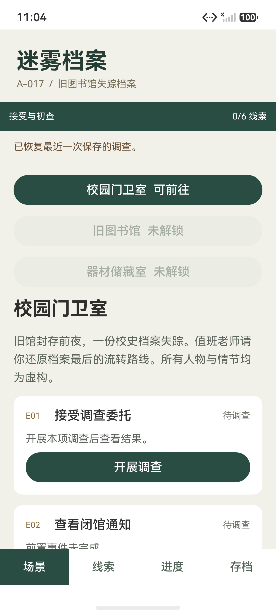
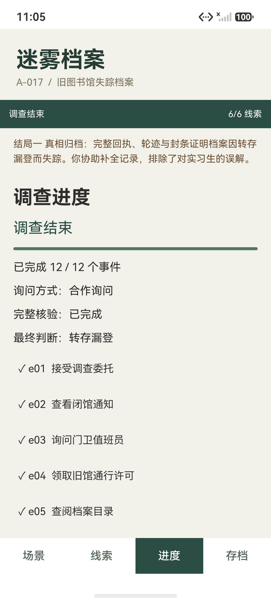
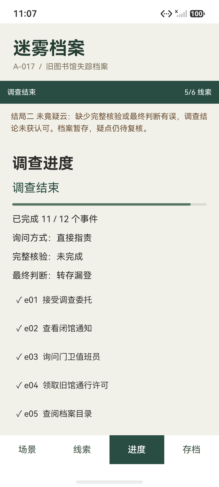
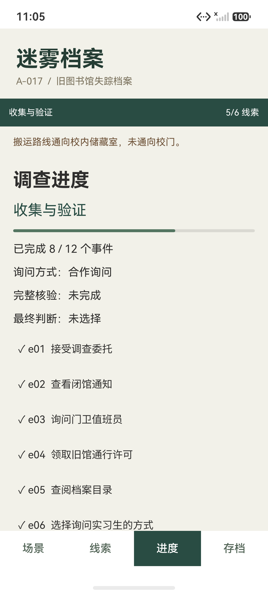
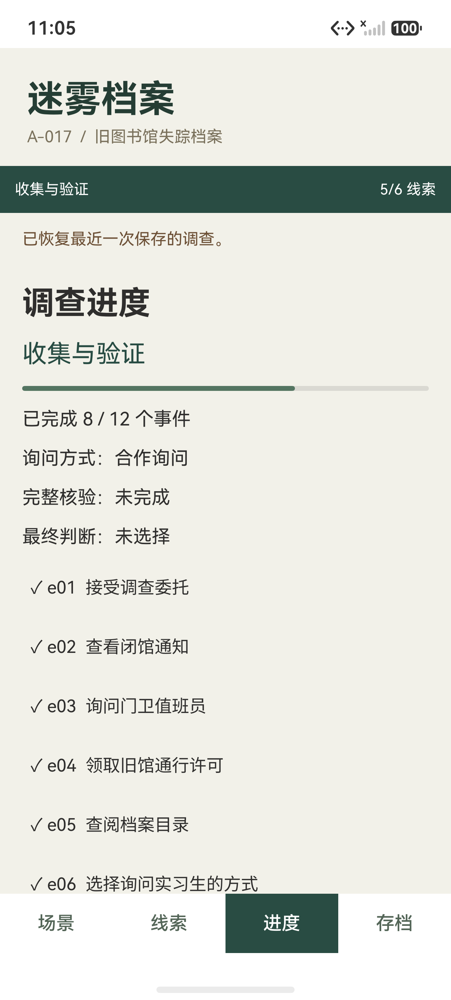

# 迷雾档案第二版

校园线索推理与多结局探索应用，使用ArkTS、ArkUI与Preferences实现。

姓名：荀怡。学号：20230313247。班级：23物联2班。独立完成。

GitHub账号：1234459-max。仓库：https://github.com/1234459-max/MistArchive-v2。

## 当前阶段

2026年11月17日先登记需求说明书与开发计划，需求提交为0814537。11月18日导入已有第二版工程及测试，并重新执行核心测试。本阶段不导入先前Git历史。

本地已有第二版工程，包含已实现的调查、线索、分支结局及存档功能。本轮在现有工程基础上逐步完成代码导入、验证、展示与报告；已有代码导入时注明复用范围，后续改动按实际完成情况提交。

## 功能与模块

应用包含门卫室、旧图书馆、器材储藏室3个场景，12个业务事件、6条线索和2种条件结局。询问方式改变证据获取；最终判断结合线索与核验状态决定结局。页面提供线索板、进度提示、自动及手动保存和确认重开。

GameEngine集中校验事件与选择；InvestigationSession协调页面读档、保存和重开；SaveCodec校验并重放存档历史；SaveRepository通过TextStore访问存储；PreferencesStore适配鸿蒙Preferences。保存成功后页面才发布新状态，失败时保留进度并允许重试。

## 本次验证

2026年11月18日使用Node v24.14.1执行32项共享核心测试，全部通过：正常8项、边界9项、异常15项。文件Mock在两个子进程间保存和读取，恢复8事件、5线索状态，通过。31份导入文件的SHA-256与本地已有工程一致。

上述核心测试直接执行类型擦除后的共享ArkTS业务代码，覆盖两种结局、重复及越级操作、存档校验、主备恢复、存储失败与重试、并发保护。该结果属于11月18日的宿主核心与Mock验证。

11月19日在当前工程重新完成DevEco原生构建，结果为BUILD SUCCESSFUL in 31 s 107 ms，输出[调试HAP](dist/MistArchive-v2-debug-unsigned.hap)。仍有3处Preferences异常处理提示和未配置签名提示。

11月19日早先因D盘空间不足及临时实例初始化失败，未能完成安装。清理后D盘剩余约14.38GB，原Mate 90 Pro实例成功启动。随后安装本次编译的HAP，11:03至11:07完成8项原生UI检查，全部通过，包含两个结局、取消重开、分支约束和实际Preferences进程终止恢复。本次完整运行未中断续测，早先的失败日志仍保留。本轮Hypium未执行。

- [结构化测试结果](evidence/host-test-results.json)
- [本次执行日志](evidence/core-test-20261118.log)
- [导入文件校验](evidence/source-import-20261118.json)
- [分支状态示例](evidence/flow-traces.json)
- [11月19日构建日志](evidence/build-20261119.log)
- [11月19日包校验与环境](evidence/build-package-20261119.json)
- [11月19日设备验证状态](evidence/native-status-20261119.json)
- [8项原生UI检查结果](evidence/native-ui-results.json)
- [D盘模拟器本次执行日志](evidence/native-ui-d-20261119.log)

## 实际运行截图

以下均为11月19日在D盘Mate 90 Pro模拟器运行本次HAP时采集的原生截图：

<p> </p>
<p> </p>
<p> </p>

## 环境与运行

工程配置对应DevEco Studio 26.0.1.290和SDK26.0.1，最低兼容配置API12，应用包名com.example.mistarchive.v2。API12实际设备兼容性尚未验证。

1. 在DevEco Studio中打开工程根目录，路径使用英文，等待OhPM与Hvigor同步。
2. 安装并选择匹配SDK，选择entry及本地模拟器，构建并运行。真实设备需要本人配置签名。
3. 从门卫室接受调查，按前置事件解锁其他场景。合作、收集完整线索、返回图书馆核验并选择转存判断可进入真相结局；缺少条件或判断错误进入未竟结局。

核心测试使用Node22.13以上版本；本次使用Node24.14.1：

```powershell
node scripts/test-core.mjs
```

原生UI脚本scripts/test-native-ui.mjs需已安装并运行中的模拟器及测试应用；会重开测试进度。MIST_HDC、MIST_DEVICE和MIST_BUNDLE可覆盖本机默认设置，执行前应核对。本次使用D盘原实例，模拟器系统HarmonyOS 7.0.0.120；连续录屏尚待完成。

## 文档

- [软件需求说明书](docs/软件需求说明书.md)
- [开发计划](docs/开发计划.md)
- [本次导入与验证记录](docs/开发记录.md)
- [原生构建与设备检查](docs/原生构建与设备检查.md)

## 后续工作

1. 根据实际运行问题完善交互或存档处理，并提交对应修改和测试。
2. 录制完整调查、两个结局、重开及进程结束后的恢复过程。
3. 完成个人Word报告，核对接口、核心代码、实际Commit和运行证据。
